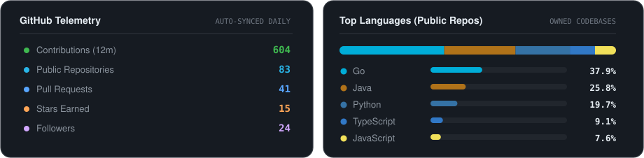

<!-- Hero Banner (Light / Dark Theme Aware) -->

  <a href="https://github.com/sandeepkv93">
    <picture>
      <source media="(prefers-color-scheme: dark)" srcset="./assets/banner-dark.svg">
      <source media="(prefers-color-scheme: light)" srcset="./assets/banner-light.svg">
      
    </picture>
  </a>

 
<!-- Quick Action Pill Bar -->

  
  
  
  
  

<!-- Neofetch Telemetry Terminal (Auto-Refreshed Daily via GitHub Actions) -->

  <picture>
    <source media="(prefers-color-scheme: dark)" srcset="./assets/terminal-dark.svg">
    <source media="(prefers-color-scheme: light)" srcset="./assets/terminal-light.svg">
    
  </picture>

 
<!-- Live GitHub Telemetry & Language Breakdown (Self-Hosted SVG) -->

  <picture>
    <source media="(prefers-color-scheme: dark)" srcset="./assets/stats-dark.svg">
    <source media="(prefers-color-scheme: light)" srcset="./assets/stats-light.svg">
    
  </picture>

 
## Engineering Journey
<table>
  <tr>
    <td width="50%" valign="top">
      <h3>Snowflake </h3>
      <b>Senior Software Engineer, Streamlit in Snowflake (SiS)</b>  
      Building a fully managed platform that brings Python application runtimes directly to data inside the Snowflake AI Data Cloud. Focus across containerized execution on Snowpark Container Services, scalability, observability, secure integrations, and developer experience.
    </td>
    <td width="50%" valign="top">
      <h3>Microsoft Azure </h3>
      <b>Senior Software Engineer, Azure Compute &amp; Partner Solutions</b>  
      Core contributor to <b>Azure Spot VMs</b> (65% to 95% cluster utilization) and led ML-based Spot replenishment (4x runtime, 5x core consumption, <a href="https://patents.google.com/patent/US12056521B2/en">US12056521B2</a>). Later led the generic Resource Provider hosting platform powering 10+ third-party Azure integrations (Datadog, Nginx, Elastic, Confluent).
    </td>
  </tr>
  <tr>
    <td width="50%" valign="top">
      <h3>VMware / Digital Fuel </h3>
      <b>Member of Technical Staff (R&amp;D)</b>  
      Engineered multi-cloud REST adapters (AWS &amp; Azure), dependency-safe deletion frameworks, and led monolith-to-microservice REST architecture transformation on vRealize Business Enterprise.
    </td>
    <td width="50%" valign="top">
      <h3>Research, Patent &amp; Education </h3>
      <b>Stony Brook University (M.S. CS) &amp; PES University (B.E. IT)</b>  
      <ul>
        <li><b>Patent:</b> <a href="https://patents.google.com/patent/US12056521B2/en">Machine-learning-based replenishment of interruptible workloads in cloud environment (US12056521B2)</a></li>
        <li><b>Publication:</b> <a href="https://dblp.org/rec/conf/latice/SandeepASK16">DSAdvisor: Facilitating Deeper Inquiry in the Data Structures Course</a> (IEEE LaTiCE 2016)</li>
      </ul>
    </td>
  </tr>
</table>
 
## Beyond My Pinned Repos
In addition to the 6 pinned repositories below, here are recent systems builds, tools, and live interactive demos:
<table>
  <tr>
    <td width="50%" valign="top">
      <a href="https://github.com/sandeepkv93/podbeacon"><b>podbeacon</b></a>
       
      Kubernetes operator for automatic OpenTelemetry Collector sidecar injection on annotated pods.
    </td>
    <td width="50%" valign="top">
      <a href="https://github.com/sandeepkv93/raft-consensus"><b>raft-consensus</b></a>
       
      Raft distributed consensus from scratch in Go with leader election, log replication, snapshotting, and a linearizable KV store.
    </td>
  </tr>
  <tr>
    <td width="50%" valign="top">
      <a href="https://github.com/sandeepkv93/otelviz"><b>otelviz</b></a>
       
      Interactive Streamlit application for testing, simulating, and visualizing OpenTelemetry Collector pipelines.
    </td>
    <td width="50%" valign="top">
      <a href="https://github.com/sandeepkv93/retry-budget-validator"><b>retry-budget-validator</b></a>
       
      TypeScript library and CLI to statically analyze declarative retry topologies and exhaustion budgets.
    </td>
  </tr>
  <tr>
    <td width="50%" valign="top">
      <a href="https://github.com/sandeepkv93/googlysync"><b>googlysync</b></a>
       
      Linux desktop client for Google Drive featuring a Go sync daemon, GTK4 UI, and FUSE streaming.
    </td>
    <td width="50%" valign="top">
      <a href="https://github.com/sandeepkv93/lps"><b>lps (Load Pattern Simulator)</b></a>
       
      Typed Python HTTP load generator and experiment runner with DuckDB analytics storage and Streamlit reporting.
    </td>
  </tr>
  <tr>
    <td width="50%" valign="top">
      <a href="https://github.com/sandeepkv93/distributed-systems-visualizer"><b>distributed-systems-visualizer</b></a>
       
      Interactive visual simulations for learning distributed systems with step controls and theory articles.
    </td>
    <td width="50%" valign="top">
      <a href="https://github.com/sandeepkv93/oidc-flow-demo"><b>oidc-flow-demo</b></a>
       
      Interactive step-by-step visual guide to the OpenID Connect (OIDC) authentication flow.
    </td>
  </tr>
</table>

  <a href="https://github.com/sandeepkv93/repo-index"><b>Explore the full categorized repository index &rarr;</b></a>

 
## Core Stack

  <picture>
    <source media="(prefers-color-scheme: dark)" srcset="https://skillicons.dev/icons?i=go,py,java,ts,c,kubernetes,docker,bazel,postgres,redis,rabbitmq,grafana,prometheus,react,tailwind,linux&perline=8&theme=dark">
    <source media="(prefers-color-scheme: light)" srcset="https://skillicons.dev/icons?i=go,py,java,ts,c,kubernetes,docker,bazel,postgres,redis,rabbitmq,grafana,prometheus,react,tailwind,linux&perline=8&theme=light">
    
  </picture>

 
## Contribution Activity

  <picture>
    <source media="(prefers-color-scheme: dark)" srcset="https://raw.githubusercontent.com/sandeepkv93/sandeepkv93/output/github-snake-dark.svg">
    <source media="(prefers-color-scheme: light)" srcset="https://raw.githubusercontent.com/sandeepkv93/sandeepkv93/output/github-snake.svg">
    
  </picture>

